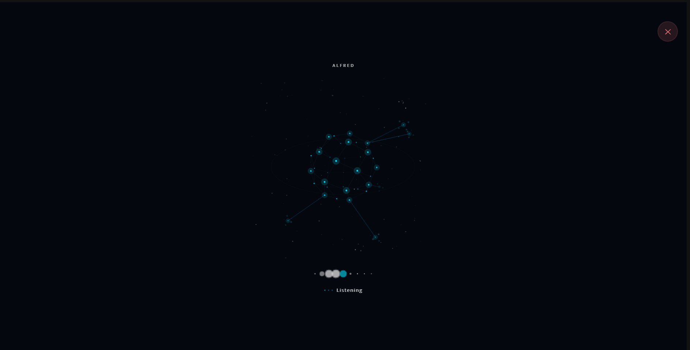
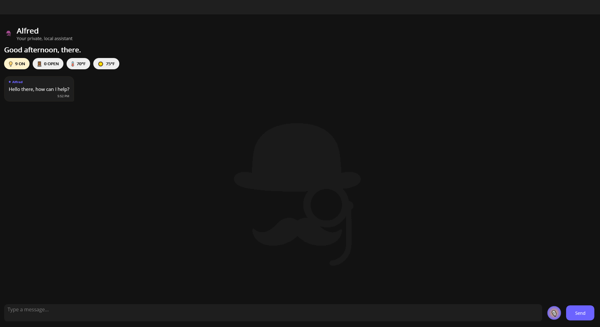
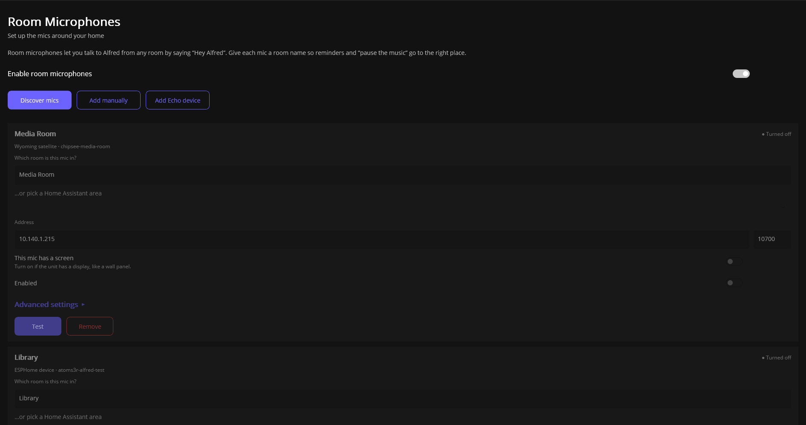

  

# Alfred
**A local-first voice assistant for Home Assistant. No LLM.**

Alfred understands natural speech and controls your smart home, your Plex/Jellyfin library and Spotify, with no custom sentences to write.

> **Status: not released yet.** This repo is a placeholder with no code. I'm aiming to open a **private beta sign-up in January**, with a public release after that once it's stable. **Watch or Star this repo** to follow along.

## What it does

- **Natural language for Home Assistant.** Alfred syncs your devices, scenes, scripts and automations from Home Assistant and runs them by name.
- **Multiple commands in one sentence.** "Pause the music, dim the lights, and open a movie."
- **Movies and shows.** Alfred checks your Plex or Jellyfin library first, then movies you own on other apps, then your streaming apps, and if it's nowhere it offers to request it on Seerr.
- **Spotify and multi-room audio.** Play music by artist or playlist, group and ungroup speakers, shuffle.
- **Room microphones.** Use cheap room mics around the house. Tested so far: a 2nd gen Echo Dot running community firmware and an M5Stack AtomS3R over ESPHome, plus Wyoming with a Raspberry Pi and touchscreen.
- **Wake word.** A custom "Hey Alfred" wake word.
- **Personas.** Formal, Witty or Concise. They change the wording, not what Alfred does.

## Integrations

| Integration | What Alfred does with it |
|---|---|
| **Home Assistant** | Syncs your devices, scenes, scripts and automations and runs them by name. Also uses your rooms (areas) and weather |
| **Plex** | Searches your library and plays what you ask for |
| **Jellyfin** | Searches your library and plays what you ask for |
| **Spotify** | Plays artists and playlists, with shuffle |
| **Seerr** | Requests movies and shows that aren't in your library or on your streaming apps, and tells you when they're ready |
| **TMDB** | Fixes misheard titles and finds which streaming services carry a title |
| **Streaming apps** | Opens the right app on your TV for a title on your services |
| **Owned movies** | Tracks movies you own on apps like Apple TV, Prime Video and Fandango. Add them by voice or with a CSV import |
| **Multi-room audio** | Groups and ungroups speakers through Home Assistant (tested on Sonos) |
| **Room mics** | ESPHome (2nd gen Echo Dot, M5Stack AtomS3R) and Wyoming (Raspberry Pi with touchscreen) |

## How it works

Speech is transcribed locally by Whisper. An intent classifier works out what you asked for, then Alfred calls Home Assistant, Plex, Jellyfin, Spotify or Seerr through their APIs. Replies are pre-rendered and cached, and the voice is Kokoro. There is no LLM, and no GPU is needed.

## Plans and status

| | |
|---|---|
| **Release** | Private beta sign-up aiming for January, then a public release |
| **Cost** | The plan is free, with optional donations, and no subscription |
| **Source** | The plan is to open source it. The license is not decided yet |
| **Platforms** | Windows first, with macOS and Linux planned |
| **Languages** | English only for now |
| **Phone app** | Planned shortly after the beta |

## FAQ

**Does it use an LLM?** No. It uses speech-to-text (Whisper), an intent classifier and cached voice replies (Kokoro).

**Is it fully offline?** It's local-first. Speech processing runs on your own PC and network. Spotify and optional lookups reach the internet.

**Do I need Home Assistant Cloud?** Not for Alfred's voice.

**What microphones work?** I've tested a 2nd gen Echo Dot (with community firmware) and an M5Stack AtomS3R over ESPHome, and Wyoming with a Raspberry Pi and touchscreen. Other ESPHome or Wyoming mics should work, but I haven't tested them. Flashing devices is done at your own risk, and Alfred has its own setup script, released with the beta.

**Google Nest or other platforms?** I'm looking into Google Nest as an option. Alfred works with Home Assistant only for now.

## Follow along

- TikTok / YouTube: **@MyAlfredAI**
- Website: myalfredai.app (in progress)

This repo isn't a support channel. Questions are welcome in the comments on the videos.
